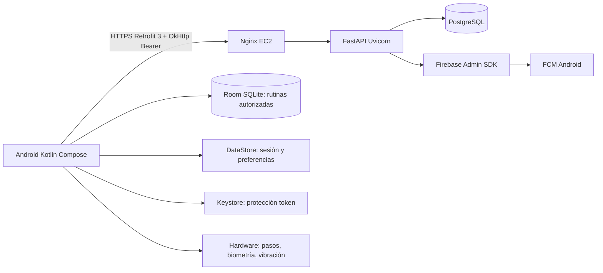
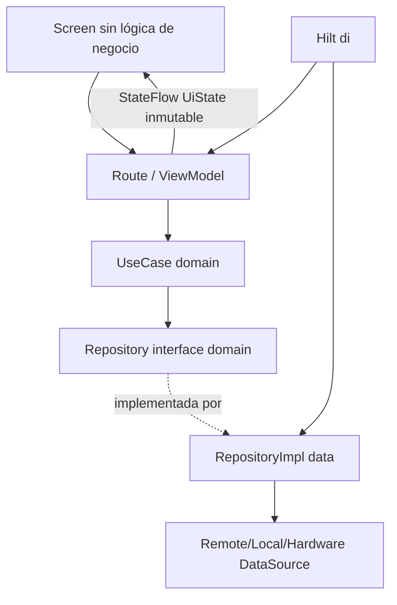
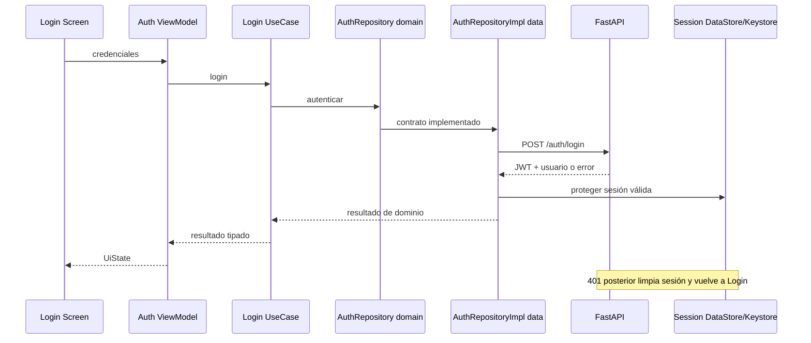
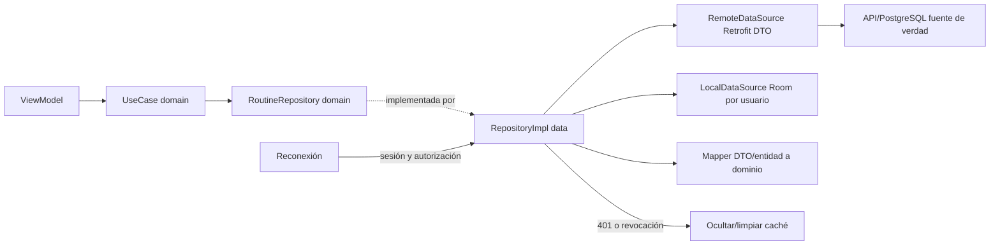
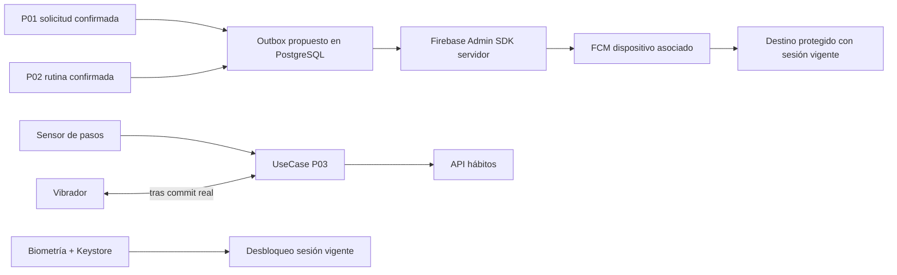
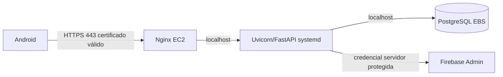

# Arquitectura propuesta

**Estado vigente R1–R2 · FitTrack Gym v6.0 (27-11-2026):** alcance aprobado por el usuario y aclaraciones docentes aportadas por él. Sustituye expresamente las reglas incompatibles v5.1 de registro libre/selección de rol, cinco hábitos/meta 3 de 5 y cumplimiento manual de pasos. Las secciones previas incompatibles se conservan como evidencia histórica, sin vigencia normativa. No se atribuye una inspección nueva de material docente. Implementación actual: autenticación e invitaciones; procesos de negocio, Room, FCM, hardware, Contactame y HTTPS siguen pendientes.

**Estado vigente 03.R.4 (27-11-2026):** alcance v5.1 aprobado expresamente por el usuario mediante D01–D11, registradas en [decisiones](decisions.md). Las menciones anteriores a aprobación pendiente de esas decisiones son históricas y quedan sustituidas por este registro. Funcionalidades futuras: PLANNED; aprobación de alcance no acredita implementación, pruebas ni aprobación docente. Cobertura visual global parcial; verificaciones externas pendientes.

## Estado real

Un módulo Android `app` con Compose y pantalla de arranque; Hilt/KSP configurados. MainActivity únicamente aloja FitTrackApp bajo FitTrackTheme. El tema único y sus tokens están en `ui/theme`; los componentes reutilizables y previews en `core/designsystem`. El sistema de diseño recibe estado y callbacks, sin dependencias hacia features. Backend FastAPI independiente con `GET /health` y módulos `core`, `db`, `auth`, `users` para la etapa 03. Existen modelo, repositorio y servicios de autenticación, además de Alembic; la migración `users` y la integración PostgreSQL fueron validadas localmente en bases aisladas. La etapa 03 aún no está publicada. No existen ViewModels Android de negocio ni sesión Android.

## Android, etapas futuras

MVVM y Clean Architecture ligera, dentro del módulo `app`, organizada por `core` y `features/auth|calculator|habits|coaching|routines`. Crear solo capas necesarias. Presentation: Route obtiene ViewModel por Hilt y recolecta `StateFlow` con ciclo de vida; Screen recibe estado/callbacks. Domain: modelos, contratos y reglas sin Android, Compose ni DTO. Data: Retrofit/DTO/mappers, DataStore y repositorios. Dependencias de presentation y data apuntan a contratos domain; domain no depende de implementaciones. `MutableStateFlow` privado, eventos transitorios separados cuando aplique.

Navigation Compose de rutas tipadas: grafos Auth, Athlete y Trainer, una Activity, RootViewModel y back stack protegido. La calculadora se comparte, sin capa data. `viewModelScope`, funciones `suspend`, cancelación cooperativa y manejo tipado de errores. Retrofit 3, OkHttp y kotlinx.serialization se añadirán cuando exista comunicación remota; AuthInterceptor no leerá DataStore con `runBlocking`. Hilt enlazará contratos e implementaciones cuando existan.

Fuentes de verdad: API/PostgreSQL para usuarios, solicitudes, vínculos y rutinas; Preferences DataStore por usuario/fecha para hábitos y para metadatos de sesión (token protegido con Keystore); memoria de ViewModel para calculadora. Esta exclusión de Room es histórica: la rúbrica oficial de Unidad 4 exige caché local consultable sin conexión; su diseño se abordará en una operación posterior, sin cambios en el backend de etapa 03.

## Backend actual y futuro

FastAPI es un monolito modular. `main.py` compone routers y errores; `core` concentra configuración, Argon2id, JWT y errores; `db` crea engine y sesión por solicitud; `auth` separa router, schemas, servicio y dependencias; `users` separa modelo, repositorio, schema público y router. Los endpoints síncronos de DB/hash se ejecutan como `def` mediante el threadpool de FastAPI. Alembic versiona `users` con revisión `bd7cce2c8602`. La configuración se carga del entorno sin secreto predeterminado; SQLAlchemy oculta parámetros en errores. `PublicUser` contiene email para identidad autenticada y no debe reutilizarse como perfil público de entrenador. `coaching` y `routines` permanecen planificados y no tienen módulos vacíos.

## Despliegue futuro

```text
Android --HTTPS--> Nginx / EC2 --localhost--> Uvicorn / FastAPI --localhost--> PostgreSQL
                        |                  |
                        +------ EBS -------+
```

Una instancia EC2 con Ubuntu, Nginx y Systemd. No se ha desplegado. Puerto 443 previsto; 80 solo redirección/certificados; 22 restringido. Uvicorn y PostgreSQL sin exposición pública. Ver [aws-deployment.md](aws-deployment.md).

## Arquitectura objetivo histórica v5.0 (sustituida donde contradice v5.1)

MainActivity aloja Compose y delega a FitTrackApp; FitTrackApplication conserva Hilt. RootViewModel y AppNavHost se crearán cuando la autenticación/navegación los necesiten. Las Routes obtendrán ViewModels por Hilt y las Screens recibirán estado/callbacks. MainActivity no contiene lógica de negocio, permisos, hardware ni Firebase.

Hardware previsto: contador TYPE_STEP_COUNTER en habits con SensorManager y callbackFlow/trySend/awaitClose; listener solo durante seguimiento activo, ACTIVITY_RECOGNITION desde API 29, DataStore por usuario/fecha, alternativa manual y manejo de reinicio/cambio de fecha. Biometría opcional con AndroidX Biometric, Keystore y operación suspend cancelable asociada al ciclo de vida; JWT remoto sigue siendo obligatorio. Háptica con VibratorManager API 31+, Vibrator API 26–30, VibrationEffect y cancelación try/finally. Contratos/casos de uso de dominio puro e implementaciones hardware en data; Hilt liga interfaces. Paquetes se crearán al implementar.

Notificaciones: FCM solo transporta eventos remotos; FastAPI/PostgreSQL conservan autoridad. Los eventos autorizados TRAINER_REQUEST_RECEIVED/ACCEPTED/REJECTED y ROUTINE_ASSIGNED se registrarán en outbox dentro de la transacción y se procesarán tras commit, con reintentos/idempotencia. Android registrará instalación autenticada, verificará usuario/permisos al recibir/abrir y desvinculará al logout. WorkManager enviará recordatorios locales de hábitos pendientes, trabajo único por usuario, horario inicial propuesto 20:00 local configurable, sin hora exacta garantizada. POST_NOTIFICATIONS API 33+, canales API 26+. Sin Firebase Authentication ni base de datos Firebase.

## Arquitectura objetivo v5.1 propuesta (sustituye exclusiones anteriores)

**Fecha:** 27-11-2026. Room es obligatorio por la rúbrica; la frase histórica sobre ausencia de caché no rige como decisión futura. `main` Android permanece sin cambios. La etapa 03 backend está integrada mediante PR #2; solo Android auth y procesos posteriores están pendientes. [RF](requirements.md) · [procesos](business-processes.md).





Domain contiene model/repository/usecase y no importa Android, Compose, DTO ni Room. DTO `@Serializable`, mappers y entidades Room permanecen en data; Hilt enlaza contratos desde di. `MutableStateFlow` privado, `StateFlow` público de solo lectura y `collectAsStateWithLifecycle`; `viewModelScope` y funciones suspend con concurrencia estructurada, propagando `CancellationException`. ViewModel consume UseCases, nunca Repository directamente. MainActivity conserva SRP. Crear capas solo al implementar una feature, sin paquetes vacíos.





Room cachea rutinas y ejercicios, no escribe offline. Debe distinguir sin caché de lista vacía, indicar última actualización y revalidar acceso al volver red; conectividad no garantiza API disponible. No mostrar datos tras 401 o revocación expresa. Política conservadora aprobada D03: acceso offline solo con sesión local protegida, JWT aún vigente y última autorización conocida para la misma cuenta. La antigüedad de los datos se muestra por separado y **no concede permiso**; no existe extensión automática de 24 horas. Al expirar el JWT, se bloquea la consulta privada incluso sin red; biometría no lo renueva. Distinguir caché inexistente, vacía válida, desactualizada, sin red, fallo API, revocación expresa y sesión expirada. Al recuperar red, revalidar y reemplazar o retirar recursos revocados. La revocación remota no puede propagarse durante desconexión. Logout limpia caché y sesión. La política está aprobada por el usuario. DataStore conserva preferencias/sesión; P03 remoto aprobado desplaza hábitos como fuente de verdad, no las observaciones auxiliares del sensor.





Backend conserva monolito modular FastAPI existente; no se traslada MVVM al servidor. El backend actual solo tiene users/auth; coaching, rutinas, hábitos, contacto y dispositivos se diseñan para fases futuras. No hay despliegue AWS actual.

## Implementación Android 04.1 · 27-11-2026

Implementada localmente en un módulo: `features/auth/domain` contiene modelos, AuthRepository/SessionRepository y UseCases puros; `data` contiene AuthApi (fuente remota Retrofit), DTOs Serializable, mapeo explícito y AuthRepositoryImpl; `presentation` contiene AuthViewModel/RootViewModel y Screens sin negocio; `di` proporciona dependencias Hilt. Las Routes consumen StateFlow con collectAsStateWithLifecycle y ViewModels mediante hiltViewModel. MainActivity permanece intacta.

La raíz compone exclusivamente el grafo público o el privado por rol. Al cambiar la sesión se descarta el NavController del grafo anterior. No hay destino de rol ajeno ni datos ficticios de negocio. Las contraseñas viven solo en memoria y se descartan al abandonar el formulario; no se usa SavedStateHandle/rememberSaveable para ellas.

`core/network` incorpora origen permitido, Bearer únicamente para recursos privados, sin redirecciones ni reintento automático de POST. No hay logs HTTP sensibles. JSON/error se transforma a errores de dominio sin mostrar mensajes internos. 401 protegido invalida solo la generación que originó la solicitud; 403 no cierra sesión.

`core/session` cifra token y vencimiento AES/GCM con nonce generado por Cipher, clave no exportable Keystore y DataStore. Operaciones de cifrado/almacenamiento en Dispatchers.IO; mutaciones serializadas con Mutex. Una generación impide que una respuesta antigua reactive sesión tras logout o invalide otra cuenta. Un temporizador restringe acceso al vencer expires_in; al restaurar se exige /users/me. Fallo temporal conserva el ciphertext vigente y bloquea la UI privada con reintento/logout. Si falla la limpieza se bloquea la restauración y se reintenta eliminar; primero se invalida la clave para inutilizar residuos cifrados. No existe permiso offline adicional, Room, biometría ni refresh en esta entrega.

Dependencias fijadas y resueltas por Gradle: Retrofit/converter 3.0.0, OkHttp 4.12.0, Serialization JSON 1.8.1/plugin Kotlin 2.2.10, DataStore 1.1.7, Navigation Compose 2.9.0, Lifecycle 2.11.0, Hilt Compose 1.2.0, coroutines-test 1.10.2. Se conserva AGP con Kotlin integrado, KSP y Hilt existentes. Release sin URL configurada queda bloqueada antes del envío; HTTPS y URL pública siguen pendientes.

## Adaptación R1–R2 v6.0

Se reutilizan las capas Android 04.1 y sesión cifrada. RegisterInput/DTO usan invitationCode/invitation_code; desaparece el selector de rol y la API sigue siendo autoridad de navegación. El código solo vive en el estado en memoria del formulario, nunca en DataStore/SavedStateHandle ni logs. Errores de invitación/capacidad se mapean a dominio y español.

Backend incorpora modelo/service de invitaciones y CLI privada app.gym_admin, sin endpoints admin ni tercer rol móvil. Hash SHA-256 de códigos aleatorios secrets.token_urlsafe(32) (256 bits); emisión después de commit muestra el código una sola vez al operador. Bloqueos PostgreSQL pg_advisory_xact_lock de claves estables por rol se comparten entre emisión, consumo, revocación y desactivación. Todas las herramientas que muten capacidad deberán respetarlos. Capacidad = límite - activos - invitaciones vigentes no consumidas/no revocadas; vencidas no reservan. Configuración de límites en entorno privado del servidor.

Próximo bloque de pasos: SensorManager/TYPE_STEP_COUNTER → callbackFlow/trySend/awaitClose en DataSource → RepositoryImpl → UseCase → ViewModel. Mantener baseline por cuenta/dispositivo/día y reinicio, acumulación diaria y observaciones idempotentes, sincronizando solo día actual con sesión válida. Observación offline no equivale a confirmación remota; sin permisos/sensor queda pendiente. No hay entrada manual ni garantía de seguimiento 24 h o antifraude absoluto.
