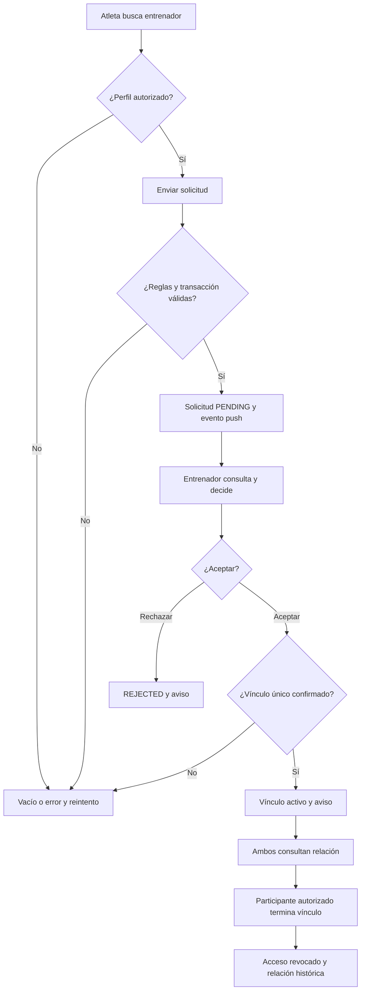
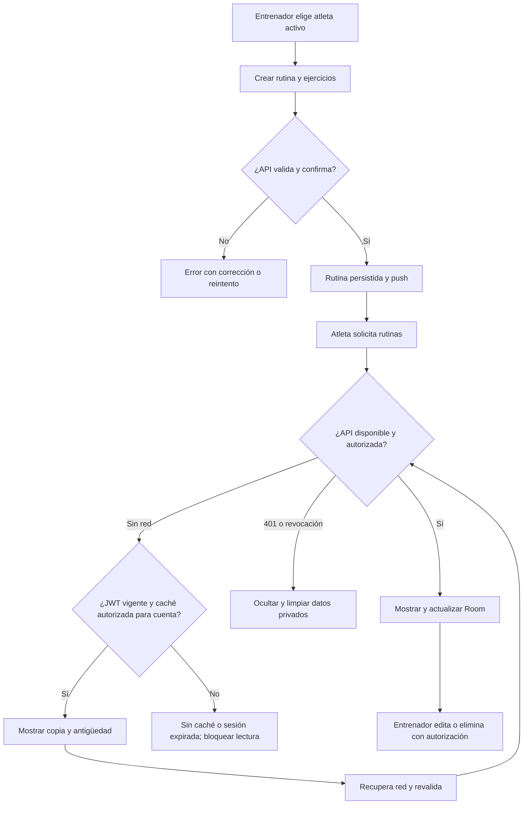
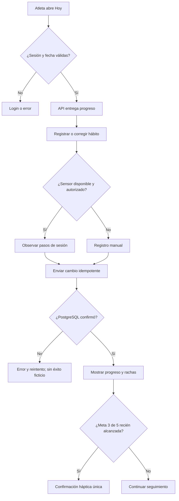
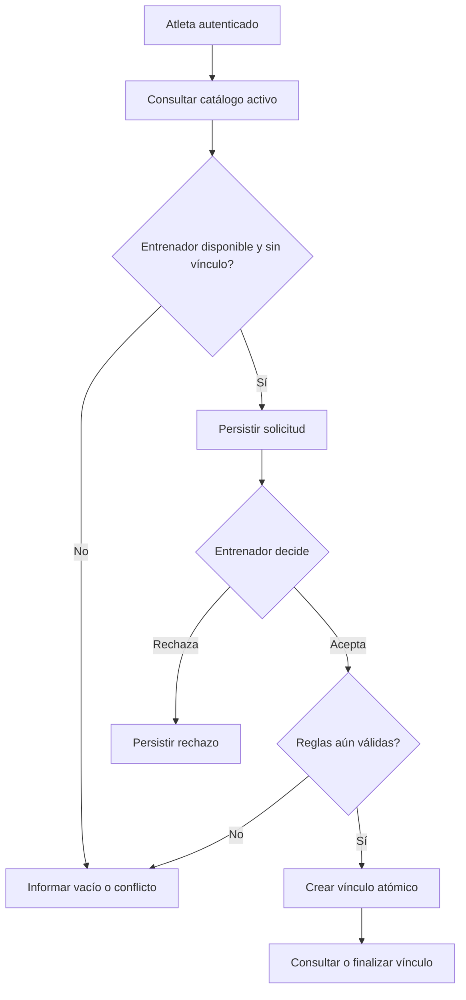
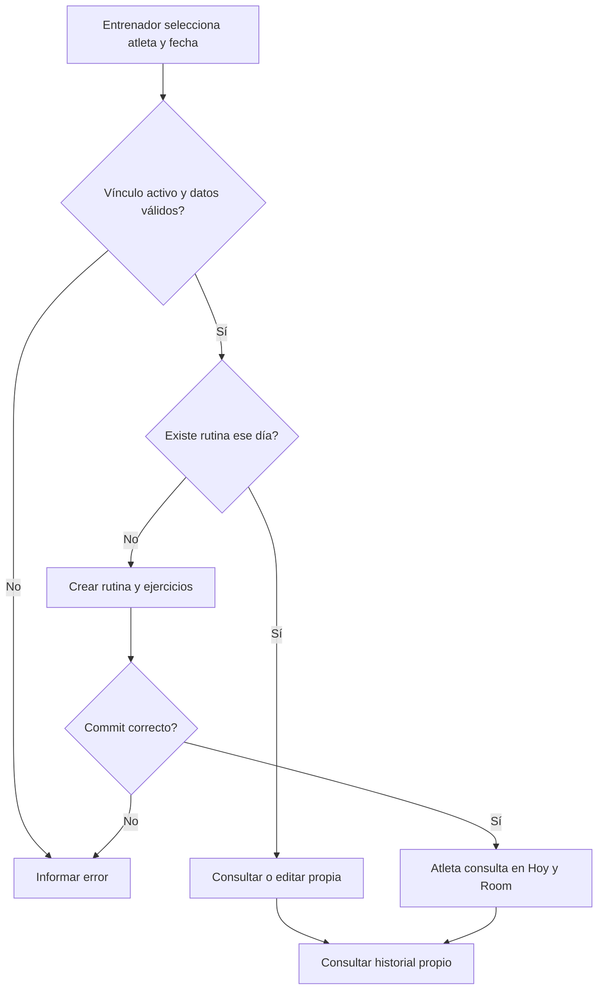
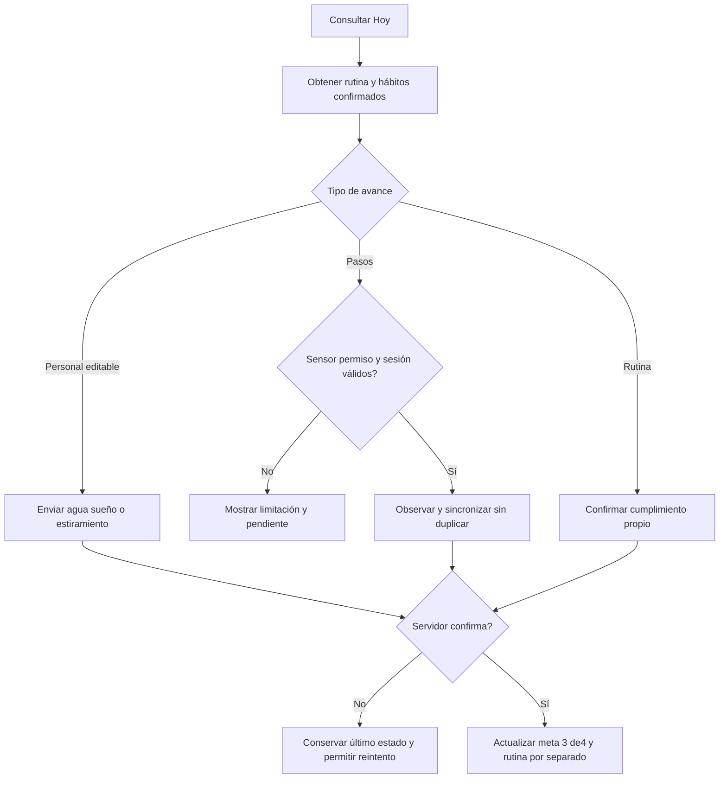

# Procesos de negocio · FitTrack v5.1 aprobado

**Estado vigente R1–R2 · FitTrack Gym v6.0 (27-11-2026):** alcance aprobado por el usuario y aclaraciones docentes aportadas por él. Sustituye expresamente las reglas incompatibles v5.1 de registro libre/selección de rol, cinco hábitos/meta 3 de 5 y cumplimiento manual de pasos. Las secciones previas incompatibles se conservan como evidencia histórica, sin vigencia normativa. No se atribuye una inspección nueva de material docente. Implementación actual: autenticación e invitaciones; procesos de negocio, Room, FCM, hardware, Contactame y HTTPS siguen pendientes.

**Estado vigente 03.R.4 (27-11-2026):** alcance v5.1 aprobado expresamente por el usuario mediante D01–D11, registradas en [decisiones](decisions.md). Las menciones anteriores a aprobación pendiente de esas decisiones son históricas y quedan sustituidas por este registro. Funcionalidades futuras: PLANNED; aprobación de alcance no acredita implementación, pruebas ni aprobación docente. Cobertura visual global parcial; verificaciones externas pendientes.

**Estado:** alcance aprobado por el usuario el 27-11-2026; P01–P03 planificados. [Requisitos](requirements.md) · [Historias](user-stories.md) · [API](api-contract.md). Ningún proceso está implementado de extremo a extremo: Android aún presenta la identidad temporal. Los datos de cada proceso procederán de la API propia y PostgreSQL. Carga, vacío, error y reintento son estados obligatorios; un éxito visual exige confirmación del servidor.

## Negocio, actores y alcance

FitTrack conecta atletas que necesitan rutinas personalizadas y hábitos saludables con entrenadores que administran atletas y planes. `ATHLETE` solicita un único vínculo activo, consulta rutinas asignadas y registra su progreso; `TRAINER` resuelve solicitudes y administra rutinas propias. Ambos usan registro, login, sesión y Contáctame. La API verifica rol, propiedad y vigencia; ocultar controles no concede ni revoca permisos. El MVP demostrará P01, P02 y P03 de inicio a fin con persistencia real y pruebas de aceptación. La calculadora, rachas, recordatorios y Deshacer permanecen planificados, con prioridad revisable; no se eliminan por este documento.

## P01 · Vinculación atleta–entrenador

**Objetivo y valor:** establecer una relación formal y revocable que habilita la asignación de rutinas. **Actores:** atleta y entrenador. **Disparador:** atleta autenticado sin vínculo activo busca entrenador. **Precondiciones:** dos cuentas válidas de roles distintos, sesión vigente, sin vínculo ni solicitud incompatible. **Recursos:** `trainer_requests`, `trainer_athletes`; `users` ya existe. **Pantallas:** Buscar entrenador, Perfil público, Estado de solicitud, Solicitudes recibidas, Mi entrenador, Mis atletas. **Historias:** HU08–HU12 y HU31; HU23 para eventos push.

**Flujo:** buscar por username o UUID → abrir perfil público sin correo ni datos de atletas → enviar solicitud → API persiste `PENDING` → entrenador recibe evento `TRAINER_REQUEST_RECEIVED` → consulta solicitudes propias → acepta o rechaza → API confirma transición, crea vínculo atómicamente solo al aceptar → atleta recibe `TRAINER_REQUEST_ACCEPTED` o `TRAINER_REQUEST_REJECTED` → ambos consultan estado → cualquiera termina el vínculo activo bajo autorización. La entrega push no define el resultado de la transacción.

**Alternativos:** entrenador inexistente: vacío/404; duplicado o pendiente incompatible: 409; atleta ya vinculado: 409; cancelar pendiente: transición `CANCELLED`; rechazo: sin vínculo; conflicto concurrente: una sola aceptación válida; rol/propiedad ajenos: 403 o 404 sin filtrar datos; token ausente/expirado: 401 y retorno seguro a login; red caída: error y reintento, sin éxito ficticio. **Reglas:** máximo un entrenador activo por atleta; un entrenador puede tener muchos atletas; solicitud aceptada permanece histórica al terminar vínculo. Índice parcial y transacción harán cumplir unicidad. Política de solicitudes múltiples y acceso histórico permanece [pendiente](decisions.md).

**Postcondición:** estado persistido y consultable, acceso a rutinas condicionado al vínculo activo. **API prevista:** `/trainers`, `/trainers/{id}`, `/coaching/requests*`, `/coaching/me`, `/coaching/athletes*`, `/coaching/relationships/{id}/end` bajo `/api/v1`. **Aceptación:** pruebas HTTP de ambos roles, transiciones, concurrencia, 401/403, estados UI y push originado por evento real.

## P02 · Gestión y asignación de rutinas

**Objetivo y valor:** entregar un plan editable por entrenador y consultable por atleta incluso sin red durante una ventana limitada. **Actores:** entrenador y atleta. **Disparador:** entrenador selecciona un atleta vinculado. **Precondiciones:** vínculo activo y sesión autorizada. **Recursos remotos:** `routines`, `exercises`; **locales propuestas:** `cached_routines`, `cached_exercises` en Room, separadas por usuario. **Pantallas:** Mis atletas, Formulario/Detalle de rutina, Mis rutinas del entrenador y del atleta. **Historias:** HU13–HU17 y HU30; HU23 para asignación push.

**Flujo:** entrenador consulta atletas propios → elige atleta activo → define rutina y ≥1 ejercicio → API valida y confirma transacción → evento `ROUTINE_ASSIGNED` → atleta consulta lista/detalle autorizados → app guarda copia Room y fecha de actualización → sin conexión muestra copia vigente con indicador → al recuperar red mientras el flujo está activo, revalida sesión y vínculo, actualiza o elimina recursos revocados → entrenador edita/elimina según propiedad. No se escribe offline.

**Alternativos:** sin atletas/rutinas: vacío real; formulario inválido: 422; vínculo terminado: 403/409; recurso oculto: 404; 401: limpiar sesión y no mostrar caché; sin red y sin copia: estado sin caché; caché vencida: no revelar datos; fallo de sincronización: conservar copia permitida e indicar antigüedad y reintento; edición concurrente: política de versión pendiente. **Reglas:** solo entrenador propietario modifica; atleta solo lee durante vínculo autorizado; ejercicios ordenados y enteros positivos; PostgreSQL es fuente de verdad. La revocación remota no puede aplicarse instantáneamente a un dispositivo desconectado.

**Postcondición:** rutina confirmada en PostgreSQL y copia local acorde a última autorización comprobada. **API prevista:** CRUD `/api/v1/routines*`, `/api/v1/coaching/athletes*`. **Aceptación:** transacción, propiedad, lista/detalle, 401/403, caché offline, aislamiento, actualización, revocación al reconectar y limpieza en logout probados.

## P03 · Seguimiento de hábitos y actividad física — propuesto

**Objetivo y valor:** confirmar progreso diario del atleta con datos persistidos y pasos observados. **Actor:** atleta. **Disparador:** abrir Hoy o corregir un hábito. **Precondiciones:** sesión vigente; fecha local y zona horaria definidas. **Recursos propuestos:** `daily_habits` remoto; DataStore solo para preferencias y observaciones auxiliares acotadas del sensor. **Pantallas:** Hoy, Seguimiento de pasos. **Historias:** HU18–HU21 y HU25–HU26 para rachas/recordatorio Should. La alternativa `routine_completions` queda fuera del MVP prioritario, según D01 aprobado.

**Flujo:** consultar día → registrar/corregir cualquiera de cinco hábitos (agua, 8 000 pasos, sueño, entrenar, estirar) → observar pasos durante sesión activa o marcar manualmente → API deriva propietario del JWT, valida fecha y actualización idempotente → confirma en PostgreSQL → devuelve progreso → UI muestra 3/5 como meta y rachas calculadas desde registros confirmados → vibración solo al confirmar por primera vez el logro correspondiente. No se conservan lecturas crudas indefinidamente ni se promete medición continua 24 horas.

**Alternativos:** sensor ausente o permiso rechazado/permanente: alternativa manual y Ajustes cuando proceda; reinicio del dispositivo/cambio de día/usuario: nueva línea base sin sumar indebidamente; error de red o persistencia: no declarar guardado, ofrecer reintento; 401/403: ocultar datos; concurrencia entre dispositivos: PUT completo con versión optimista y conflicto 409; recargar antes de reintentar. La fecha de seguimiento es local del atleta con zona IANA validada; marcas de auditoría UTC. La racha no se rompe durante el día aún abierto si ayer cumplió; se conserva historial suficiente para la mejor racha.

**Postcondición:** progreso diario real confirmado por API, visible solo a su propietario. **API propuesta:** `GET /api/v1/habits/daily/{date}`, `PUT /api/v1/habits/daily/{date}` para creación/reemplazo y corrección con versión, `DELETE /api/v1/habits/daily/{date}` para restablecer el día propio, `GET /api/v1/habits/history`; no se propone PATCH simultáneo. **Aceptación:** aislamiento, meta 3/5, fechas, corrección, concurrencia, paso manual/sensor, error/reintento y vibración posterior al commit probados.

**Revisión 03.R.2.1:** P03 distingue día ausente (200 con `exists:false`), creación con versión esperada nula, PUT completo con versión, consulta histórica y DELETE explícito con versión; el borrado recalcula rachas. El servidor no suma observaciones de pasos de varios dispositivos. En P02, la antigüedad de la copia no otorga autorización: solo hay lectura offline con sesión protegida, JWT vigente y última autorización conocida; la expiración bloquea el detalle. FCM puede fallar o retrasarse sin invalidar un vínculo o rutina ya confirmados. Véase [contrato API](api-contract.md).

## Procesos rectores v6.0

### P01 · Selección y vinculación
Atleta invitado/autenticado consulta catálogo de entrenadores activos del único gimnasio, selecciona por username/UUID y envía solicitud; entrenador activo acepta/rechaza; ambos consultan/cancelan/finalizan conforme a propiedad. Máximo un vínculo activo por atleta. Persistencia futura trainer_requests/trainer_athletes. Sin chat, grupos ni cuentas ADMIN móviles. Errores: cuenta inactiva/401, entrenador inactivo/no encontrado, vínculo existente, duplicado/409, prohibido/403 y fallo de red con reintento. Push informa, no condiciona la transacción. HU08–HU13, HU23, HU31–HU34; pruebas de propiedad, concurrencia, catálogo activo y ausencia de datos privados. Estado PLANNED; solo prerequisito auth/invitaciones implementado.

### P02 · Gestión de rutinas diarias
Entrenador propietario selecciona atleta vinculado activo y fecha; crea rutina/ejercicios, consulta historial de sus asignaciones y edita/elimina según política vigente. Unicidad (atleta, fecha) validada en PostgreSQL; conflicto concurrente 409. Atleta recibe aviso y consulta su rutina diaria en Hoy/Detalle; Room mantiene copia autorizada de solo lectura, con JWT vigente y revalidación al reconectar. Recursos futuros routines/exercises; eventos ROUTINE_ASSIGNED. HU14–HU17/HU27/HU30/HU35/HU36, RF-60/RF-61. Precondiciones: sesión, roles y vínculo; postcondición: asignación confirmada. Sin vínculo, cuenta inactiva, fecha inválida, recurso ajeno, sesión expirada o red fallida no producen éxito ficticio. Estado PLANNED; pruebas de unicidad, fechas, CRUD, propiedad y cache.

### P03 · Cumplimiento y seguimiento
Atleta consulta Hoy con rutina diaria y cuatro hábitos: agua (8 vasos), caminar (8000 pasos), sueño (7 h) y estirar (10 min). Marca/corrige solo agua/sueño/estiramiento. Seguimiento activo observa pasos y sincroniza día actual idempotentemente con sesión válida; servidor deriva walk_completed. Rutina tiene cumplimiento independiente y no suma un hábito. Meta personal >=3 de4; rachas se derivan de hábitos confirmados y se recalculan ante corrección/DELETE confirmado conforme D04. Hábitos privados, entrenador solo consulta historial de sus rutinas. Sin sensor/permiso, caminar queda pendiente sin alternativa manual. Sin red solo observación local, nunca cambio confirmado. Recursos futuros daily_habits/routine_completions/routines; contratos detallados pendientes. HU18–HU21/HU25/HU26/HU35/HU36, RF-60–RF-62. Pruebas: propiedad, fechas, conflictos, duplicados de observación, reinicio/dispositivo y meta separada. Estado PLANNED; hardware no implementado en R1–R2.

