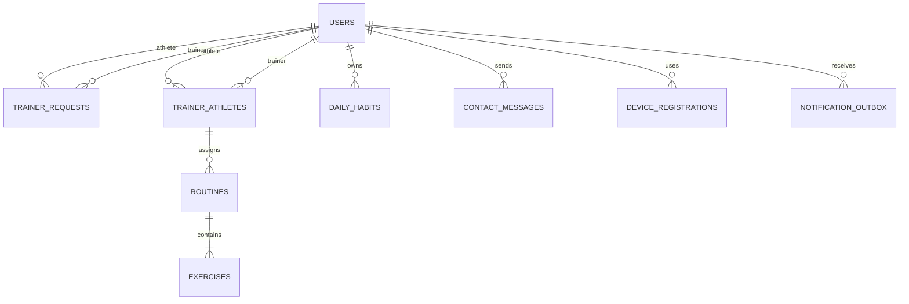
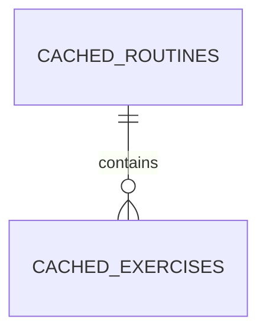

# Modelo relacional de FitTrack

**Estado vigente 03.R.4 (27-11-2026):** alcance v5.1 aprobado expresamente por el usuario mediante D01–D11, registradas en [decisiones](decisions.md). Las menciones anteriores a aprobación pendiente de esas decisiones son históricas y quedan sustituidas por este registro. Funcionalidades futuras: PLANNED; aprobación de alcance no acredita implementación, pruebas ni aprobación docente. Cobertura visual global parcial; verificaciones externas pendientes.

**Estado:** la etapa 03 añadió el modelo SQLAlchemy y la migración Alembic `bd7cce2c8602` únicamente para `users`. Se aplicó y comprobó en PostgreSQL 18.6 local sobre `fittrack_dev` y `fittrack_test`, con roles propietarios separados y sin acceso cruzado. Las restantes entidades siguen planificadas. Desarrollo y pruebas usarán PostgreSQL local/aislado; producción usará PostgreSQL dentro de la misma EC2 que FastAPI, nunca RDS.

`users`: UUID generado por servidor; `username` y `email` únicos en base y normalizados por API; `name` no único; `password_hash` Argon2id; `role` limitado por CHECK a `ATHLETE` o `TRAINER`; `created_at` y `updated_at` son `TIMESTAMPTZ` UTC asignados por servidor. No se ejecuta `create_all` ni migración al importar la aplicación.

| Entidad | Clave y campos propuestos | Relaciones y restricciones |
|---|---|---|
| `users` | `id UUID PK`, `username`, `name`, `email`, `password_hash`, `role`, `created_at`, `updated_at` | Username y correo únicos normalizados; rol `ATHLETE/TRAINER`; hash nunca en API. |
| `trainer_requests` | `id UUID PK`, `athlete_id FK`, `trainer_id FK`, `status`, `created_at`, `resolved_at?` | Índices por participantes/estado; transición terminal. Índice parcial para una pendiente por atleta si se aprueba. |
| `trainer_athletes` | `id UUID PK`, `trainer_id FK`, `athlete_id FK`, `started_at`, `ended_at?`, `ended_by? FK` | Un entrenador tiene muchos vínculos; índice único parcial por atleta donde `ended_at IS NULL`. Historial conservado. |
| `routines` | `id UUID PK`, `trainer_athlete_id FK`, `name`, `muscle_group`, `level`, `duration_min`, `created_at`, `updated_at`, `deleted_at?` | Propietario y atleta se derivan del vínculo; duración positiva; exactamente un vínculo. |
| `exercises` | `id UUID PK`, `routine_id FK`, `name`, `sets`, `repetitions`, `position` | Series/repeticiones positivas, posición no negativa y única por rutina; al menos uno por rutina validado en transacción. |

La API validará roles, propiedad, vínculo activo y fechas. Aceptación de solicitud/vínculo, desvinculación, asignación y CRUD de rutina serán transaccionales; restricciones de PostgreSQL resolverán carreras de aceptación. No duplicar contadores ni IDs de dueño en rutinas. Reasignar dentro de rutinas del mismo entrenador; terminar vínculo revocará acceso del atleta según política propuesta. La eliminación lógica requiere aprobación de la estrategia Deshacer.

Datos Android: DataStore de sesión con ID, rol y token cifrado por Keystore; DataStore de hábitos con ID de usuario, fecha local e IDs de hábitos completados. La calculadora permanece en memoria. No almacenar contraseñas, rutinas remotas ni métricas del atleta en la cuenta entrenador.

## Extensión v5.0 propuesta, sin migración actual

| Entidad | Campos propuestos | Regla |
|---|---|---|
| device_registrations | id, user_id, installation_id, registration_token, is_active, created_at, updated_at | Instalación ligada a usuario autenticado; evitar registros activos duplicados; desvincular al logout. |
| notification_outbox | id, recipient_id, event_type, resource_id, status, attempts, created_at, next_attempt_at, processed_at | Registrar en transacción de negocio; procesar después de commit; reintentos controlados. |

Plan histórico v5.0: siete entidades principales en PostgreSQL y hábitos locales; queda sustituido para la propuesta v5.1. DataStore conserva preferencias y datos auxiliares del sensor; no almacenar biometría. Estas dos entidades son propuestas técnicas, no tablas existentes.

## Modelo objetivo v5.1 propuesto — sin migraciones nuevas

**Fecha:** 27-11-2026. La afirmación histórica de siete entidades y hábitos solo DataStore queda sustituida para el alcance propuesto. **Solo `users` está implementada** mediante Alembic `bd7cce2c8602`. Las demás tablas necesitan aprobación, migraciones futuras y pruebas PostgreSQL. `notification_outbox` es decisión técnica propia, no exigencia literal docente. [Procesos](business-processes.md) · [API](api-contract.md).

| Entidad y estado | Propósito y campos propuestos | Claves, reglas, propiedad y eliminación |
|---|---|---|
| `users` IMPLEMENTED | UUID, username/name/email, hash, role, tiempos UTC | PK UUID; UNIQUE username/email; CHECK rol; no exponer hash. |
| `trainer_requests` PLANNED | UUID, athlete_id, trainer_id, status, created_at, resolved_at | FK users, CHECK estado, índices actor/estado, pendiente única por atleta por aprobar; historial, sin borrado físico ordinario. |
| `trainer_athletes` PLANNED | UUID, trainer_id, athlete_id, started_at, ended_at, ended_by | FK users; UNIQUE parcial atleta con ended_at NULL; relación histórica; acceso solo participantes. |
| `routines` PLANNED | UUID, trainer_athlete_id, nombre/grupo/nivel/duración, tiempos, deleted_at opcional | FK vínculo; duración positiva; propietario entrenador del vínculo; eliminación lógica solo si se aprueba Deshacer. |
| `exercises` PLANNED | UUID, routine_id, nombre, series, repeticiones, posición | FK rutina, CHECK positivos, UNIQUE (routine_id,position); eliminar junto a rutina según política. |
| `device_registrations` PLANNED | UUID, user_id, installation_id, registration_token protegido, active, tiempos | FK users, UNIQUE instalación activa, índice user_id; desasociar logout; nunca publicar token. |
| `notification_outbox` PROPOSED | UUID, recipient_id, event_type, resource_id, status, attempts, next_attempt_at, processed_at | FK destinatario, índices estado/fecha; reintentos tras commit; política de retención pendiente. |
| `contact_messages` PLANNED | UUID, sender_id FK obligatorio, sender_name y sender_email instantáneos derivados de users, subject, message, created_at | Solo usuario autenticado; nombre/correo nunca aceptados del cuerpo; retención durante operación/evaluación MVP aprobada; antiabuso técnico pendiente; no confundir persistencia con envío de email. |
| `daily_habits` PLANNED | UUID, user_id FK, local_date DATE, time_zone IANA, cinco booleanos, observed_steps no negativo, steps_source, version, created_at/updated_at TIMESTAMPTZ | UNIQUE (user_id,local_date), CHECK pasos≥0, CHECK versión>0; solo atleta propietario; PUT completo con versión, DELETE propio con versión; DELETE físico propio aprobado D04, comprobando UUID de instancia y versión. |

La propuesta de un registro por día evita tablas por cada hábito fijo. Las marcas de auditoría usan UTC; `local_date` se calcula con la zona IANA validada del atleta, nunca se equipara a la fecha UTC. El servidor obtiene `user_id` del JWT verificado. No almacenar lecturas crudas indefinidamente ni contadores de racha duplicados; derivarlos del historial confirmado. En P03 el cumplimiento manual y los pasos observados son datos distintos; la API decide el estado confirmado. No existe `routine_completions` en el MVP prioritario.

### Modelo local Room propuesto — SQLite, separado de PostgreSQL

`cached_routines`: clave compuesta `(owner_user_id,routine_id)`, vínculo/entrenador visibles, campos de lista/detalle, `last_authorized_at`, `last_synced_at`. `cached_exercises`: clave `(owner_user_id,routine_id,exercise_id)`, posición y datos de ejercicio; FK compuesta a rutina y borrado en cascada local. DAO consulta por dueño, sustituye lista/ejercicios autorizados en transacción y elimina al logout/revocación. Migraciones Room versionadas; pruebas de DAO, esquema, aislamiento y sustitución. La API/PostgreSQL es fuente de verdad; Room es copia. `owner_user_id` procede de sesión protegida, nunca de un campo arbitrario de UI.

**Corrección 03.R.2.1:** `daily_habits` ausente significa día sin registro, no error. DELETE del propio día deja ausencia y obliga a recalcular rachas; se aplica borrado físico D04 con identidad de instancia y versión, sin reutilizar UUID al recrear. Las observaciones de pasos son valores absolutos de la fuente activa, no incrementos para sumar entre dispositivos; cambio de fuente requiere recarga y confirmación. En Room, `last_synced_at` expresa antigüedad, **no autorización**. Acceso offline exige sesión local protegida y JWT vigente; no hay permiso extra de 24 horas. La expiración bloquea lectura privada. Solo `users` tiene migración aplicada.
